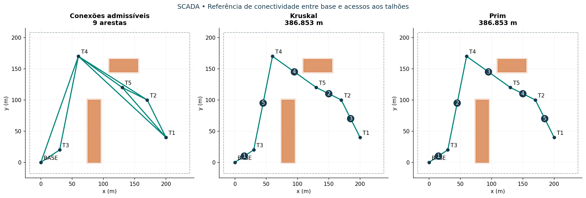

# Aula 19 — Algoritmos de Kruskal e Prim

**ECAA08 — Arquitetura de Sistemas SCADA | Grupo 06**  
**Integrantes:** Arthur, Caique, Luis Felipe e Marina  
**Planta:** Sistema SCADA aplicado a um Drone Agrícola de Pulverização  
**Etapa 3:** Árvores — planejamento e execução supervisionada de missões de pulverização

## 1. Contexto e objetivo no SCADA

O servidor SCADA disponibiliza ao operador uma referência de conectividade entre a base e os acessos T1–T5. Uma ligação existe somente quando o segmento entre dois pontos é admissível no mapa. A árvore geradora mínima (AGM) reduz a soma desses comprimentos e ajuda a discutir o mapa disponível para o planejamento.

Os vértices são posições geográficas locais, em metros; as arestas representam possibilidades de deslocamento aéreo. Nenhum comprimento representa tubulação. A HMI pode exibir o grafo, a AGM e os pontos isolados. A saída desta aula não autoriza aplicação nem especifica a sequência completa de visita e retorno.

## 2. Modelo e fundamentação

Para um grafo simples não dirigido $G=(V,E)$ com pesos $w$, buscamos uma árvore que conecte todos os vértices e minimize $\sum_{e\in T}w(e)$. Usamos $w(u,v)=\|p_u-p_v\|_2$. Uma árvore conectada tem $|V|-1$ arestas; uma floresta com $c$ componentes tem $|V|-c$. A contagem precisa ser acompanhada da verificação de conectividade.

Kruskal ordena arestas e utiliza conjuntos disjuntos para evitar ciclos: $O(E\log E)$ para ordenação, além do custo quase linear das uniões. Prim expande uma fronteira a partir da BASE; a implementação *lazy* utiliza heap de arestas, com $O(V+E\log E)$. Ambos aplicam escolhas gulosas justificadas pela propriedade do corte. Empates podem produzir árvores diferentes com o mesmo custo.

O mapa é o mesmo da Aula 22. A geometria utiliza raio ilustrativo de 0,6 m e folga de 1,4 m; a margem total de 2 m é uma hipótese desta etapa. Obstáculos são inflados e as bordas externas reduzidas. São verificadas interseções de segmentos completos, inclusive tangência.

## 3. Procedimento e demonstração

1. Construir todas as conexões admissíveis entre os seis pontos herdados da Aula 17.
2. Mostrar as decisões de Kruskal, incluindo rejeições por ciclo.
3. Iniciar Prim na BASE e comparar a ordem das escolhas.
4. Verificar as componentes por busca independente e comparar o custo com enumeração exata desta pequena instância.
5. Remover as ligações de T1 e demonstrar a floresta resultante.

Pergunta para a apresentação: por que uma AGM não é um circuito de missão? Porque não inclui uma ordem com retorno e pode exigir repetição de arestas para visitar todos os ramos.

## 4. Experimentos e evidências

[Notebook executável](19_Algoritmo_de_Kruskal_e_Prim.ipynb) · [Código comum](Arquivos_de_Apoio/scada_arvores.py) · [Verificações](Arquivos_de_Apoio/verificacoes.py)

- Decisões dos dois algoritmos
- Mapa e floresta após interdição

### Resultados obtidos

Kruskal e Prim obtiveram custo de **386,853 m**, com 6 vértices e 5 arestas na árvore, a partir de 9 conexões admissíveis. A checagem independente confirma conectividade, ausência de ciclos e custo mínimo.

## 5. Interpretação, limites e continuidade

A AGM é referência de conectividade e soma de ligações, não uma rota completa nem um cálculo de autonomia. Ela fornece uma cota para certos passeios no mesmo grafo com pesos não negativos, mas não pode ser comparada diretamente com um trajeto contínuo do RRT. Vento e energia não estão incluídos nos pesos. Uma desconexão deste grafo de seis pontos também não prova ausência de caminho no espaço livre: o RRT poderá criar pontos intermediários.

Na Aula 28, seu resultado aparece como informação de planejamento para a supervisão. A autorização de aplicação permanece vinculada aos permissivos e ao operador.

## 6. Referências

- [Sedgewick e Wayne — Algorithms](https://algs4.cs.princeton.edu/home/), capítulos de grafos, busca e compressão.
- [Referência curricular do professor](https://github.com/valerio-unifei/ECAA08-2026.2-Projeto/tree/main/etapa-03-arvores). Organização consultada em 16/11/2026; aplicações e figuras desta entrega são do drone.