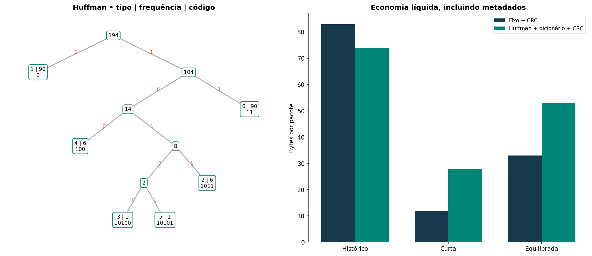

# Aula 20 — Codificação de Huffman

**ECAA08 — Arquitetura de Sistemas SCADA | Grupo 06**  
**Integrantes:** Arthur, Caique, Luis Felipe e Marina  
**Planta:** Sistema SCADA aplicado a um Drone Agrícola de Pulverização  
**Etapa 3:** Árvores — planejamento e execução supervisionada de missões de pulverização

## 1. Contexto e objetivo no SCADA

A RTU pode acumular um bloco de eventos para transmissão ou arquivamento, e o servidor SCADA precisa recuperá-los sem perdas. A aplicação desta aula comprime a coluna `tipo` do histórico: início de faixa, término, pausa, retorno, alerta e conclusão. Instantes, IDs e outras variáveis do processo não estão incluídos no tamanho medido.

O catálogo de seis tipos é compartilhado pelas duas pontas. A distribuição vem de um histórico sintético de 90 faixas, com alertas e pausas em intervalos definidos. O experimento serve à telemetria e ao historiador; o processamento imediato de alarmes não aguarda o fechamento desse bloco.

## 2. Modelo e fundamentação

Huffman combina os dois nós menos frequentes até formar uma árvore. Folhas representam símbolos; caminhos de 0 e 1 formam códigos livres de prefixos. Para frequências $f_i$ e comprimentos $\ell_i$, o payload tem $B_H=\sum_i f_i\ell_i$ bits. A árvore minimiza o comprimento médio entre códigos binários de prefixo para essas frequências. A construção com heap custa $O(m\log m)$ para $m$ símbolos; contar ocorrências custa $O(N)$.

O protocolo didático HF serializa: assinatura de 2 bytes, número de eventos de 4 bytes, número de símbolos de 1 byte e comprimento útil de 4 bytes. Cada entrada do dicionário contém ID (1 byte), comprimento (1 byte) e código preenchido até bytes inteiros. O payload também é preenchido e o quadro recebe CRC-32 (4 bytes). Assim:

$$S_H=11+\sum_i(2+\lceil\ell_i/8\rceil)+\lceil B_H/8\rceil+4.$$

A referência fixa FX usa assinatura, número de eventos, três bits por evento e o mesmo CRC: $S_F=6+\lceil3N/8\rceil+4$. Inteiros são big-endian. Um único símbolo recebe código `0`; uma mensagem vazia possui apenas cabeçalho e CRC.

## 3. Procedimento e demonstração

1. Mostrar frequências, fusões e códigos da árvore.
2. Serializar um pacote HF real em bytes, incluindo seu dicionário.
3. Decodificar somente a partir dos bytes, sem fornecer a árvore original ao receptor.
4. Comparar payload e pacote completo com a codificação fixa.
5. Repetir com mensagem curta, distribuição equilibrada e pacote corrompido.

Pergunta para a apresentação: por que um alerta raro pode ter código longo? Porque frequência não representa prioridade operacional.

## 4. Experimentos e evidências

[Notebook executável](20_Codificacao_de_Huffman.ipynb) · [Código comum](Arquivos_de_Apoio/scada_arvores.py) · [Verificações](Arquivos_de_Apoio/verificacoes.py)

- Frequências e códigos
- Pacotes completos e economia líquida

### Resultados obtidos

Nos 194 eventos, o pacote Huffman ocupa **74 bytes**, incluindo 18 bytes de dicionário; a alternativa fixa ocupa **83 bytes**. A recuperação é exata. O exemplo curto demonstra que o custo do dicionário pode eliminar o ganho.

## 5. Interpretação, limites e continuidade

O ganho depende do bloco e do formato transmitido. Não se usa o tamanho da string Python de zeros e uns como tamanho de comunicação. CRC detecta muitos erros acidentais, mas não é autenticação nem garantia absoluta de integridade. Não implementamos rádio, retransmissão ou protocolo industrial real.

A Aula 21 indexa os registros completos; Huffman preserva a sequência de tipos. Na Aula 28, a pequena sequência de eventos pode crescer após a compressão: o resultado negativo é mostrado, sem omitir o custo do dicionário.

## 6. Referências

- [Princeton — Data Compression](https://algs4.cs.princeton.edu/55compression/index.php).
- [Python — zlib e CRC-32](https://docs.python.org/3/library/zlib.html).
- [Referência curricular do professor](https://github.com/valerio-unifei/ECAA08-2026.2-Projeto/tree/main/etapa-03-arvores). Organização consultada em 16/11/2026; aplicações e figuras desta entrega são do drone.