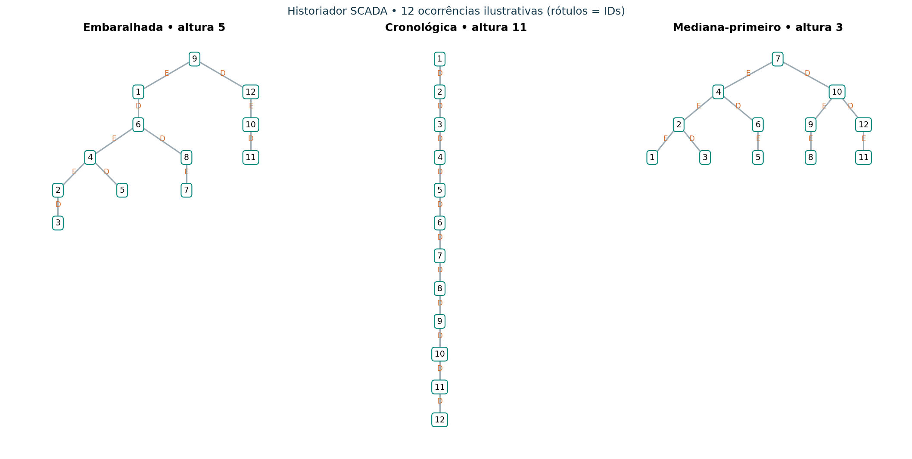

# Aula 21 — Árvores binárias

**ECAA08 — Arquitetura de Sistemas SCADA | Grupo 06**  
**Integrantes:** Arthur, Caique, Luis Felipe e Marina  
**Planta:** Sistema SCADA aplicado a um Drone Agrícola de Pulverização  
**Etapa 3:** Árvores — planejamento e execução supervisionada de missões de pulverização

## 1. Contexto e objetivo no SCADA

O historiador SCADA armazena os eventos de uma missão e oferece consultas para a HMI: localizar uma ocorrência, recuperar uma janela de tempo e reconstruir a ordem cronológica. A estrutura estudada é uma árvore binária de busca (BST).

A chave é `(instante_ms, id)`, para manter dois eventos simultâneos distintos. O ID é da ocorrência, não o código do tipo. O histórico desta aula usa os mesmos registros da Aula 20. Cada árvore aceita apenas uma missão; unir missões exigiria ampliar a chave ou normalizar o tempo.

## 2. Modelo e fundamentação

Uma árvore binária possui até dois filhos por nó. Uma BST exige que toda a subárvore esquerda tenha chaves menores e toda a direita tenha chaves maiores. A ordem das tuplas é lexicográfica: primeiro o instante, depois o ID.

Inserção e busca custam $O(h+1)$, onde $h$ é a altura em arestas. O percurso em ordem produz chaves ordenadas; pré-ordem visita raiz–esquerda–direita e pós-ordem visita esquerda–direita–raiz. Os percursos completos custam $O(n)$. A consulta inclusiva de intervalo poda ramos e custa $O(h+k+1)$ para $k$ resultados.

A altura da árvore vazia é −1. Uma sequência crescente pode criar altura $n-1$. Inserir medianas de um conjunto já conhecido produz uma referência equilibrada, mas não implementa AVL. As operações são iterativas para evitar o limite de recursão em árvores degeneradas.

## 3. Procedimento e demonstração

1. Inserir os registros em ordem embaralhada com semente fixa.
2. Buscar uma chave presente e outra ausente.
3. Exibir os três percursos e comparar o percurso em ordem com `sorted`.
4. Consultar o instante de um alerta e sua pausa simultânea.
5. Construir árvores com chegada cronológica e mediana-primeiro; comparar alturas.

Pergunta para a apresentação: por que receber eventos em ordem cronológica pode ser ruim para uma BST simples? Porque cada inserção pode seguir até a extremidade direita, aumentando progressivamente a altura.

## 4. Experimentos e evidências

[Notebook executável](21_Arvores_Binarias.ipynb) · [Código comum](Arquivos_de_Apoio/scada_arvores.py) · [Verificações](Arquivos_de_Apoio/verificacoes.py)

- Inserções, buscas e percursos
- Degeneração por chegada ordenada

### Resultados obtidos

Para 194 eventos, a inserção embaralhada produziu altura **13**, enquanto a inserção ordenada produziu altura **193** (altura contada em arestas). As consultas mantêm a ordem por instante e identificador.

## 5. Interpretação, limites e continuidade

A BST organiza dados, sem escolher comandos ou diagnosticar falhas. Não é a árvore de comportamento da Aula 25 nem a árvore aprendida da Aula 27. A versão didática não oferece persistência, acesso concorrente ou exclusão. A regra de ID único evita reinserções, mas sua atribuição deve ser consistente na aquisição.

Na Aula 28, cada decisão do supervisor vira um registro consultável. Em uma implantação real, o historiador exigiria persistência e sincronização de relógios; a BST aqui demonstra a estrutura de indexação.

## 6. Referências

- [Princeton — Binary Search Trees](https://algs4.cs.princeton.edu/32bst/).
- [Referência curricular do professor](https://github.com/valerio-unifei/ECAA08-2026.2-Projeto/tree/main/etapa-03-arvores). Organização consultada em 16/11/2026; aplicações e figuras desta entrega são do drone.