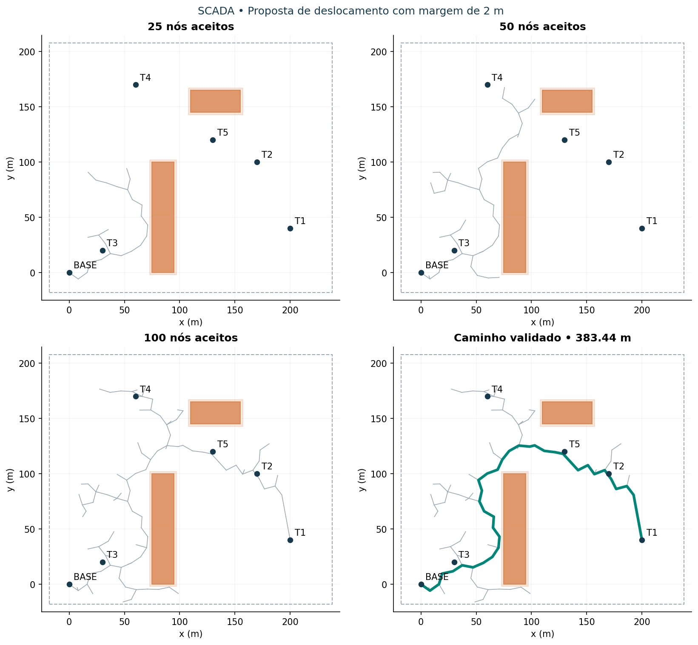

# Aula 22 — Rapidly-exploring Random Trees — RRT

**ECAA08 — Arquitetura de Sistemas SCADA | Grupo 06**  
**Integrantes:** Arthur, Caique, Luis Felipe e Marina  
**Planta:** Sistema SCADA aplicado a um Drone Agrícola de Pulverização  
**Etapa 3:** Árvores — planejamento e execução supervisionada de missões de pulverização

## 1. Contexto e objetivo no SCADA

O operador solicita no SCADA um deslocamento da posição atual à entrada de um talhão. O servidor calcula uma proposta geométrica que contorna obstáculos conhecidos, apresenta-a no mapa e registra o resultado do planejamento. A posição inicial do exemplo é BASE e o destino é T1.

O caminho é uma informação para execução supervisionada. Não representa a cobertura completa do talhão nem libera a bomba durante o deslocamento. Esta aula trata o drone como unidade móvel, preservando a aplicação agrícola.

## 2. Modelo e fundamentação

RRT começa na posição inicial e amostra configurações no plano. Escolhe o nó mais próximo e estende a árvore por um passo limitado. Se $a$ é o nó escolhido e $q$ a amostra:

$$q_{novo}=a+\min(1,\eta/\|q-a\|)(q-a),$$

com passo $\eta=10$ m. O viés de amostragem para o destino é 0,12 e o orçamento padrão é 2.500 iterações. Uma aresta só é inserida se todo o segmento estiver livre. Pais sempre têm índices menores que seus filhos; por isso não há ciclos.

O corpo é representado por um disco ilustrativo de raio 0,6 m com folga de 1,4 m. A inflação retangular dos obstáculos é conservadora nos cantos em relação ao disco exato. Não se infere o tamanho real do drone. O planejador é 2D: obstáculos são interdições verticais e a altitude é assumida adequada. Busca linear de vizinho leva a um limite de $O(K^2+KO)$ para $K$ iterações e $O$ obstáculos.

## 3. Procedimento e demonstração

1. Verificar que o segmento direto BASE–T1 é interditado.
2. Executar a busca com semente 22 e mostrar três estágios de crescimento.
3. Extrair o caminho pelos pais e somar seus segmentos.
4. Verificar colisões por um segundo método geométrico: orientações contra os lados dos retângulos.
5. Repetir com dez sementes e com barreira total, início inválido e orçamento zero.

Pergunta para a apresentação: o esgotamento de iterações prova que não existe caminho? Não; é um resultado limitado ao orçamento da busca.

## 4. Experimentos e evidências

[Notebook executável](22_Rapidly_exploring_Random_Trees.ipynb) · [Código comum](Arquivos_de_Apoio/scada_arvores.py) · [Verificações](Arquivos_de_Apoio/verificacoes.py)

- Planejamento e crescimento
- Variabilidade entre dez sementes

### Resultados obtidos

Com a semente de referência, o RRT encontrou um caminho de **383,443 m**, com 100 nós após 150 iterações. Todos os segmentos passam na verificação de colisão. O caminho encontrado não é uma solução ótima garantida.

## 5. Interpretação, limites e continuidade

O RRT básico retorna o primeiro caminho encontrado e não garante ótimo global. Não foram modelados vento, dinâmica, consumo energético, velocidade de execução ou cobertura agrícola. A margem é geométrica e não certificação de operação. Posição confiável e permissivos continuam necessários.

Na Aula 26, KD-Trees são estudadas separadamente como índice espacial. Esta implementação do RRT mantém busca linear, de forma explícita. Na Aula 28, os caminhos de ida e retorno são validados antes das confirmações simuladas de fase.

## 6. Referências

- [LaValle — About RRTs](https://lavalle.pl/rrt/about.html).
- [LaValle — Planning Algorithms](https://lavalle.pl/planning/).