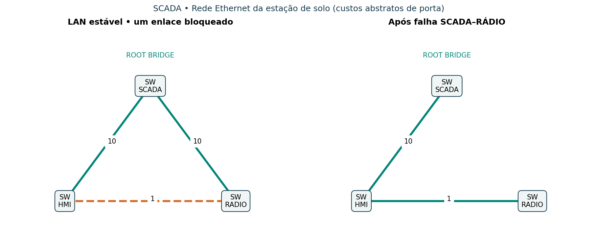

# Aula 23 — Protocolo de Árvore Geradora — STP / RSTP

**ECAA08 — Arquitetura de Sistemas SCADA | Grupo 06**  
**Integrantes:** Arthur, Caique, Luis Felipe e Marina  
**Planta:** Sistema SCADA aplicado a um Drone Agrícola de Pulverização  
**Etapa 3:** Árvores — planejamento e execução supervisionada de missões de pulverização

## 1. Contexto e objetivo no SCADA

A estação de solo pode possuir servidor SCADA, HMI e gateway de rádio conectados por uma LAN Ethernet redundante. Esta é uma ampliação didática da arquitetura inicial: três switches e enlaces ponto a ponto. O STP evita loops de camada 2 bloqueando portas redundantes; o RSTP acrescenta mecanismos de convergência rápida.

O enlace sem fio entre drone e gateway é representado separadamente como disponibilidade de telemetria. Não afirmamos que STP roteia o drone, otimiza a missão aérea ou resolve a perda do rádio. As tags dos switches são novas e identificadas como equipamentos da estação de solo.

## 2. Modelo e fundamentação

O bridge raiz é o de menor Bridge ID (prioridade e identificador). Cada bridge não raiz escolhe uma root port pelo menor custo até a raiz, com desempates determinísticos. Em cada enlace, o anúncio superior determina a designated port. Uma porta alternativa fica em discarding no modelo RSTP. A topologia de encaminhamento estável é acíclica.

A seleção implementada é centralizada e calcula o resultado estável de uma LAN simples, com custos simétricos, sem enlaces paralelos e sem VLANs. Não é uma pilha de BPDUs. Os papéis são calculados por custo de caminho e IDs dos bridges/portas. Uma partição é informada, sem inventar comunicação entre componentes.

STP não minimiza a soma global dos enlaces. No exemplo, os custos SCADA–HMI e SCADA–RÁDIO são 10, enquanto HMI–RÁDIO custa 1. A árvore enraizada custa 20; uma AGM custa 11. A linha do tempo STP usa listening, learning e forwarding; a RSTP usa proposta, sincronização e acordo. Os tempos escolhidos são parâmetros ilustrativos, não medições.

## 3. Procedimento e demonstração

1. Eleger `SW_SCADA` como raiz pela prioridade configurada.
2. Exibir todas as portas, papéis e estados estáveis.
3. Comparar o resultado com Kruskal para mostrar que STP e AGM têm objetivos distintos.
4. Retirar o enlace SCADA–RÁDIO e calcular a nova topologia.
5. Comparar linhas do tempo didáticas de STP e RSTP e discutir perda de telemetria durante reconvergência.

Pergunta para a apresentação: recuperar a LAN comprova que o rádio do drone está funcionando? Não. São trechos diferentes da comunicação.

## 4. Experimentos e evidências

[Notebook executável](23_Protocolo_de_Arvore_Geradora_STP_RSTP.ipynb) · [Código comum](Arquivos_de_Apoio/scada_arvores.py) · [Verificações](Arquivos_de_Apoio/verificacoes.py)

- Eleição, papéis e falha de enlace
- Estados e temporização assumida

### Resultados obtidos

A raiz eleita é **SW_SCADA**. A árvore do STP custa **20**, enquanto a AGM do mesmo grafo custa **11**: são objetivos diferentes. A falha de enlace produz uma nova árvore estável no modelo.

## 5. Interpretação, limites e continuidade

Na linha do tempo STP, a detecção da falha é suposta imediata e cada forward delay é 15 s. No modelo RSTP, cada troca modelada leva 20 ms e depende da hipótese de enlaces ponto a ponto sincronizáveis. Não se promete um tempo universal de reconvergência. Ausência de recebimento recente faz o supervisor pausar a aplicação; a última leitura não é tratada como atual.

A Aula 28 simula uma janela de indisponibilidade após uma falha de enlace e consulta a nova topologia. Não há switches físicos ou rádio real. BPDUs completos, envelhecimento MAC, VLANs e compatibilidade entre versões ficam fora do simulador.

## 6. Referências

- [Cisco — STP/RSTP: papéis, sincronização e proposal/agreement](https://www.cisco.com/c/dam/en/us/td/docs/switches/lan/catalyst9500/software/release/16-12/configuration_guide/lyr2/configuring_multiple_spanning_tree_protocol.html).