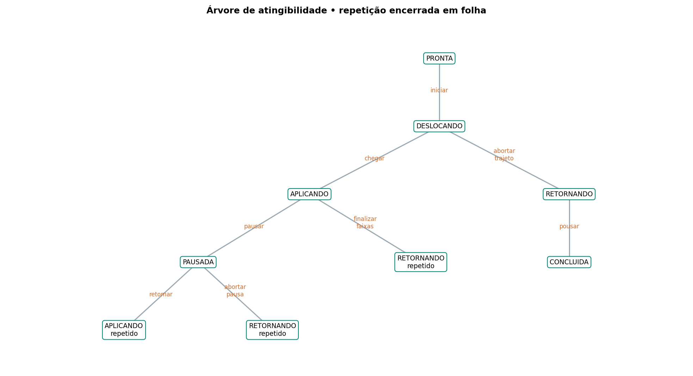
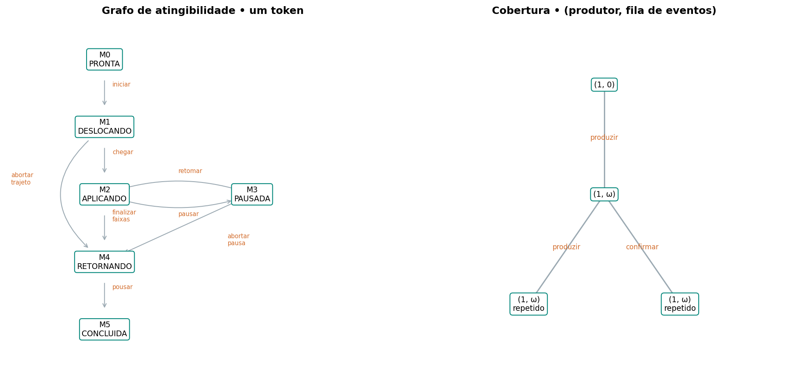

# Aula 24 — Árvore de atingibilidade e cobertura em Redes de Petri

**ECAA08 — Arquitetura de Sistemas SCADA | Grupo 06**  
**Integrantes:** Arthur, Caique, Luis Felipe e Marina  
**Planta:** Sistema SCADA aplicado a um Drone Agrícola de Pulverização  
**Etapa 3:** Árvores — planejamento e execução supervisionada de missões de pulverização

## 1. Contexto e objetivo no SCADA

O SCADA precisa distinguir estados de missão e transições permitidas. A rede de Petri modela PRONTA, DESLOCANDO, APLICANDO, PAUSADA, RETORNANDO e CONCLUIDA. O token representa a fase da missão, não litros, carga elétrica ou a posição contínua do drone.

Uma segunda rede representa o acúmulo de eventos aguardando confirmação de recebimento. Ela permite estudar cobertura com crescimento não limitado, conectando a teoria ao historiador e à telemetria do sistema.

## 2. Modelo e fundamentação

Uma rede P/T usa lugares, transições e matrizes Pre e Post. Uma transição $t$ está habilitada quando $M\geq Pre(:,t)$; seu disparo resulta em $M'=M-Pre(:,t)+Post(:,t)$. Na rede de missão há sempre um token: $\mathbf{1}^{T}M=1$. Logo os lugares são 1-limitados, e APLICANDO e PAUSADA não podem estar marcados simultaneamente.

A árvore de atingibilidade desdobra transições a partir de $M_0$. Uma marcação já descoberta é representada como folha repetida; o grafo correspondente funde repetições. A exploração completa da pequena rede encontra todas as marcações e identifica o estado terminal CONCLUIDA. Um limite de exploração excedido gera erro de análise incompleta.

Na rede de fila, produzir preserva um token de produtor e acrescenta um evento; confirmar consome um evento. Karp–Miller compara a marcação com seus ancestrais e substitui crescimento repetível por $\omega$. Cobertura pergunta se alguma marcação alcançável domina uma marcação-alvo; não exige igualdade. $\omega$ não representa uma quantidade física de memória nem uma marcação exata.

## 3. Procedimento e demonstração

1. Listar Pre e Post das transições da missão.
2. Construir o grafo e a árvore de atingibilidade com repetições identificadas.
3. Conferir o invariante de um token e a exclusão entre aplicação e pausa.
4. Construir a cobertura da fila e testar o alvo `(produtor=1, fila=100)`.
5. Comparar a rede limitada com a fila sem limite configurado.

Pergunta para a apresentação: uma folha sem transições é sempre um defeito? Não. CONCLUIDA é o término normal desta missão; um bloqueio inesperado em outra fase exigiria análise.

## 4. Experimentos e evidências

[Notebook executável](24_Arvore_de_Atingibilidade_e_Cobertura_em_Redes_de_Petri.ipynb) · [Código comum](Arquivos_de_Apoio/scada_arvores.py) · [Verificações](Arquivos_de_Apoio/verificacoes.py)

- Rede limitada e árvore de atingibilidade
- Cobertura da fila de eventos

### Resultados obtidos

O modelo de missão apresenta **6 marcações alcançáveis e 8 arcos**. A árvore de cobertura da fila possui 4 nós e identifica crescimento ilimitado por ω. Esse resultado da fila não descreve a capacidade física de uma memória real.

## 5. Interpretação, limites e continuidade

Os permissivos de vento, bateria, comunicação e aprovação são guardas externas verificadas pelo supervisor da Aula 25. A rede P/T não comprova essas condições contínuas. A transição retomar só é solicitada após a avaliação supervisória.

O resultado de cobertura mostra que uma política sem limite de fila permite acúmulo arbitrário. A solução operacional exigiria capacidade, descarte controlado ou contrapressão; nenhuma dessas políticas é presumida. O algoritmo de cobertura implementado aplica-se a redes P/T ordinárias, sem arcos inibidores ou resets. Na Aula 28, cada mudança de fase é conferida contra as marcações alcançáveis.

## 6. Referências

- [Berkeley — Petri Nets e coverability tree](https://chess.eecs.berkeley.edu/design/2010/lectures/mocPetri.pdf).
- [Esparza — Petri Nets, lecture notes](https://www.cse.iitb.ac.in/~akshayss/courses/cs735/Esparza-lecture-notes.pdf).