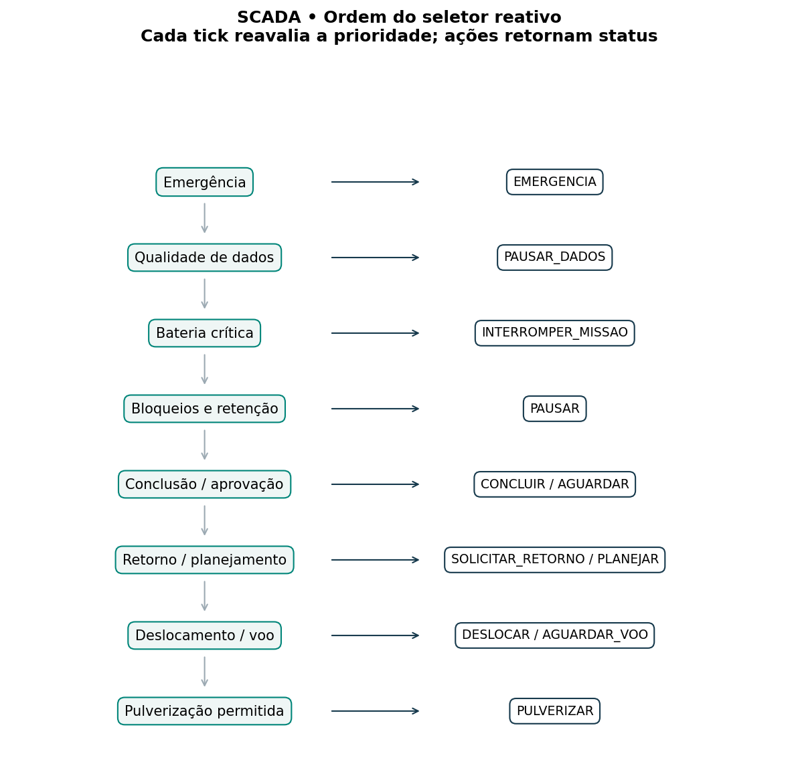

# Aula 25 — Árvores de comportamento

**ECAA08 — Arquitetura de Sistemas SCADA | Grupo 06**  
**Integrantes:** Arthur, Caique, Luis Felipe e Marina  
**Planta:** Sistema SCADA aplicado a um Drone Agrícola de Pulverização  
**Etapa 3:** Árvores — planejamento e execução supervisionada de missões de pulverização

## 1. Contexto e objetivo no SCADA

A árvore de comportamento organiza as prioridades do supervisor SCADA: avaliar emergência e qualidade da telemetria, tratar bloqueios, aguardar aprovação, propor deslocamento e solicitar aplicação. O resultado é uma solicitação simulada, acompanhada de motivo e trilha de avaliação para a HMI.

A aquisição/controladora local permanece responsável pela atuação real e pelos controles de voo. O código não substitui firmware, não comanda motores e não envia mensagens a equipamentos. A retenção de falha evita que o desaparecimento do sintoma após desligar a bomba seja interpretado como reparo.

## 2. Modelo e fundamentação

As folhas retornam SUCCESS, FAILURE ou RUNNING. Uma sequência avança enquanto recebe SUCCESS e para em FAILURE ou RUNNING. Um seletor avança enquanto recebe FAILURE e para em SUCCESS ou RUNNING. Os compostos são reativos: a cada tick recomeçam pelo filho de maior prioridade.

Condições leem o blackboard e ações escrevem solicitações. Antes de cada tick, a solicitação da bomba é zerada. Assim uma ação de aplicação anteriormente RUNNING não mantém seu comando quando um bloqueio prioritário surge. Não há tarefa assíncrona real que necessite cancelamento no firmware.

Os limiares do diagnóstico seguem a convenção integrada da Aula 10 e a continuidade da Aula 15: pressão alta >5 bar; baixa <1 bar; vazão baixa <0,5 L/min durante operação estabilizada; nível crítico <5%; bateria crítica <10%; vento alto >8 m/s. Nível ou bateria <20% motivam solicitação de retorno quando não existem bloqueios prioritários. Dados ausentes, não finitos ou inválidos impedem autorização. A idade máxima de 2 s é uma hipótese nova desta etapa.

## 3. Procedimento e demonstração

1. Mostrar a ordem das condições e o funcionamento de sequência e seletor.
2. Executar ticks normais, vento alto, bateria crítica, GPS inválido e telemetria vencida.
3. Injetar indício de obstrução, desligar o feedback da bomba e demonstrar a retenção.
4. Tentar rearmar sem inspeção e demonstrar o bloqueio.
5. Confirmar inspeção e emitir pulso de rearme com dados válidos e sem alarmes ativos.

Pergunta para a apresentação: por que a árvore pode retornar RUNNING enquanto solicita pausa? Porque a ação supervisória de aguardar condições permanece em andamento; isso não significa bomba ligada.

## 4. Experimentos e evidências

[Notebook executável](25_Arvores_de_Comportamento.ipynb) · [Código comum](Arquivos_de_Apoio/scada_arvores.py) · [Verificações](Arquivos_de_Apoio/verificacoes.py)

- Retenção e rearme supervisionado
- Prioridades e preempção

### Resultados obtidos

Os **11 cenários de bloqueio** foram aprovados, assim como a retenção de falha e a sequência de inspeção e rearme. Os testes verificam a saída final da bomba, além da ação selecionada.

## 5. Interpretação, limites e continuidade

A bomba solicitada ainda atravessa uma barreira final: dados válidos, ausência de alarmes, ausência de retenção, aprovação, caminho válido, presença na faixa e voo confirmado. A classificação aprendida da Aula 27 nunca altera esse permissivo.

Falha de GPS ou comunicação impede presumir que um retorno automático seja seguro; o simulador pausa e entrega a situação à lógica local/operador. Bateria crítica interrompe a missão, sem inventar um pouso ou retorno garantido. A política de retorno com bateria baixa é didática e não calcula autonomia. A partida dinâmica da bomba não é modelada: diagnósticos de pressão e vazão recebem a indicação externa `estabilizado`.

O diagrama agrupa alguns ramos para legibilidade; a implementação apresenta todos os filhos do seletor. A Aula 28 registra cada tick e verifica sua coerência com a rede de Petri.

## 6. Referências

- [Colledanchise e Ögren — Behavior Trees in Robotics and AI](https://arxiv.org/abs/1709.00084).
- [Continuidade e tags do grupo](Arquivos_de_Apoio/Continuidade_e_Hipoteses.md).