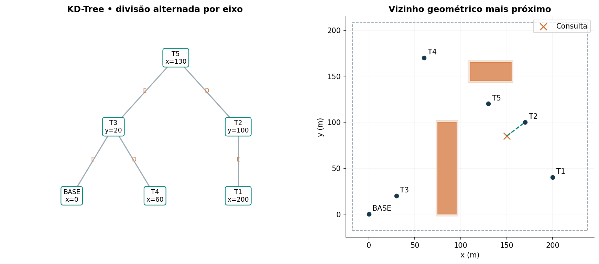

# Aula 26 — KD-Trees

**ECAA08 — Arquitetura de Sistemas SCADA | Grupo 06**  
**Integrantes:** Arthur, Caique, Luis Felipe e Marina  
**Planta:** Sistema SCADA aplicado a um Drone Agrícola de Pulverização  
**Etapa 3:** Árvores — planejamento e execução supervisionada de missões de pulverização

## 1. Contexto e objetivo no SCADA

O SCADA apresenta um mapa e precisa localizar pontos próximos à posição recebida: entradas de talhão, base e ocorrências georreferenciadas. A KD-Tree indexa coordenadas e permite consultas de vizinho mais próximo ou de todos os pontos dentro de um raio.

Nesta etapa ela atua como serviço de consulta espacial do servidor. Na Aula 28, o replay usa a posição do cenário para identificar o ponto cadastrado mais próximo. O índice não decide a viabilidade de deslocamento e não considera obstáculos.

## 2. Modelo e fundamentação

Uma KD-Tree divide o conjunto por eixos alternados. Em 2D, a raiz usa x, o nível seguinte y, depois x novamente. Construímos pela mediana, preservando um identificador distinto para pontos coincidentes. A implementação ordena a cada nível, com construção $O(n\log^2 n)$ e memória de nós $O(n)$, além das listas temporárias.

Na busca exata, visitamos primeiro o lado da consulta. O outro lado só pode ser descartado quando a distância ao plano de divisão é maior que a melhor distância encontrada. Usamos a comparação inclusiva no empate para preservar o menor ID. A poda é justificada pelo limite inferior da distância ao plano, não pela distância a um ponto arbitrário.

Em dados favoráveis e baixa dimensão, muitas consultas visitam poucos nós; o pior caso continua $O(n)$. A consulta por raio usa poda semelhante e pode retornar vários IDs. Distâncias são euclidianas em metros locais, não graus de latitude/longitude.

## 3. Procedimento e demonstração

1. Construir a árvore dos pontos do mapa e mostrar os eixos de divisão.
2. Buscar o vizinho de uma posição de consulta.
3. Comparar 100 consultas em 402 pontos com busca exaustiva.
4. Validar consulta por raio, árvore vazia e coordenadas duplicadas.
5. Contar nós examinados em vez de prometer ganho baseado em poucos microssegundos.

Pergunta para a apresentação: o ponto mais próximo é sempre o mais fácil de alcançar? Não. Obstáculos, condições operacionais e recursos podem invalidar a escolha.

## 4. Experimentos e evidências

[Notebook executável](26_KD_Trees.ipynb) · [Código comum](Arquivos_de_Apoio/scada_arvores.py) · [Verificações](Arquivos_de_Apoio/verificacoes.py)

- Índice espacial e consulta no mapa
- Referência exaustiva e casos degenerados

### Resultados obtidos

Foram comparadas **100 consultas em 402 pontos** com busca exaustiva. Os resultados coincidem, incluindo desempates; a média foi de **14,2 nós visitados**. O desempenho depende da distribuição dos pontos.

## 5. Interpretação, limites e continuidade

Este índice é estático; a inserção de novos pontos exige reconstrução no exemplo. Atualizar uma KD-Tree durante o crescimento de um RRT requer política adicional de reconstrução ou buffer de pontos. O RRT desta entrega continua explicitamente linear; não se atribui à Aula 22 um ganho não implementado.

Coordenadas coincidentes têm IDs distintos e os empates são determinísticos. Antes de usar uma posição na HMI, a camada supervisória deve verificar a qualidade do GPS. A árvore apenas responde à consulta geométrica.

## 6. Referências

- [SciPy — KDTree](https://docs.scipy.org/doc/scipy/reference/generated/scipy.spatial.KDTree.html).
- [SciPy — consulta de vizinhos](https://docs.scipy.org/doc/scipy/reference/generated/scipy.spatial.KDTree.query.html). As funções da entrega são implementações próprias, sem dependência de SciPy.