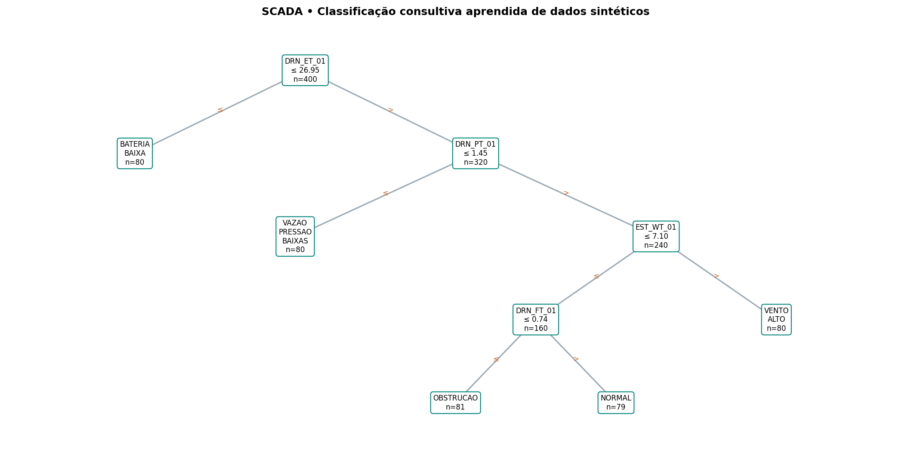

# Aula 27 — Árvores de decisão — algoritmos clássicos de construção

**ECAA08 — Arquitetura de Sistemas SCADA | Grupo 06**  
**Integrantes:** Arthur, Caique, Luis Felipe e Marina  
**Planta:** Sistema SCADA aplicado a um Drone Agrícola de Pulverização  
**Etapa 3:** Árvores — planejamento e execução supervisionada de missões de pulverização

## 1. Contexto e objetivo no SCADA

O servidor SCADA pode oferecer uma hipótese de classificação operacional ao operador, com base em pressão, vazão, bateria e vento. As classes do experimento são normal, obstrução, vazão/pressão baixas, bateria baixa e vento alto. Os rótulos correspondem a cenários sintéticos injetados, não a diagnósticos confirmados em campo.

O classificador é consultivo: a HMI pode exibir sua sugestão ao lado dos alarmes determinísticos. Seu resultado não aciona a bomba, não elimina retenções e não autoriza retorno.

## 2. Modelo e fundamentação

Implementamos uma árvore binária gulosa para atributos contínuos com critérios Gini e entropia. Para proporções de classes $p_c$:

$$Gini=1-\sum_c p_c^2,\qquad H=-\sum_c p_c\log_2p_c.$$

Cada divisão candidata usa um atributo e o ponto médio entre valores distintos. Escolhemos a menor impureza ponderada dos filhos, respeitando profundidade e tamanho mínimo de folha. Essa é uma construção de estilo CART; trocar Gini por entropia não transforma a implementação em ID3 ou C4.5.

Também implementamos ID3 categórico, com ganho de informação e ramos por categoria. Atributos são discretizados por faixas de engenharia declaradas antes da separação dos dados. Categoria não vista retorna a classe majoritária do nó. C4.5 é discutido por sua razão de ganho e tratamento de atributos, mas não é implementado.

São 30 missões sintéticas com 20 amostras por missão. Treino, validação e teste são separados por missão, evitando colocar amostras da mesma missão nos dois lados. A árvore binária escolhe critério e profundidade pela validação; o teste é reservado até a escolha final.

## 3. Procedimento e demonstração

1. Gerar os cenários e registrar missão, atributos e classe.
2. Exibir os grupos de treino, validação e teste e verificar que são disjuntos.
3. Comparar seis combinações: Gini/entropia e profundidades 2, 3 e 4.
4. Mostrar matriz de confusão, acurácia e macro-F1 da configuração escolhida.
5. Executar o ID3 com discretização fixa e informar suas métricas separadamente.
6. Demonstrar que uma sugestão NORMAL não remove um bloqueio por vento.

Pergunta para a apresentação: alta acurácia sintética comprova diagnóstico real? Não. O resultado pode refletir apenas a separação definida no gerador.

## 4. Experimentos e evidências

[Notebook executável](27_Arvores_de_Decisao.ipynb) · [Código comum](Arquivos_de_Apoio/scada_arvores.py) · [Verificações](Arquivos_de_Apoio/verificacoes.py)

- Treino, seleção e teste por missão
- ID3 categórico e barreira supervisória

### Resultados obtidos

A seleção por validação escolheu **Gini, profundidade 4**. No conjunto de teste sintético, acurácia e macro-F1 foram **1,00**. As missões de treino, validação e teste são distintas; o resultado não demonstra desempenho em dados de campo.

## 5. Interpretação, limites e continuidade

O gerador é propositalmente pequeno e controlado. Não contém diversidade agronômica, calibração de sensores, falhas simultâneas completas ou mudança de domínio. O conjunto de teste é independente por missão, mas provém do mesmo gerador. Uma acurácia elevada não estabelece segurança, causalidade ou desempenho em campo.

A classe vazão/pressão baixas representa uma hipótese ambígua; não localiza vazamento nem distingue toda falha de bomba. Dados não finitos impedem sugestão. A profundidade limitada e o mínimo de amostras por folha são pré-poda; não implementamos poda por custo-complexidade. Na Aula 28, o modelo treinado é usado somente para preencher a coluna de sugestão da HMI.

## 6. Referências

- [Scikit-learn — Decision Trees](https://sklearn.org/stable/modules/tree.html), critérios, divisões e diferenças entre algoritmos.
- [Quinlan — Induction of Decision Trees](https://doi.org/10.1007/BF00116251), ID3. Implementações próprias nesta entrega.