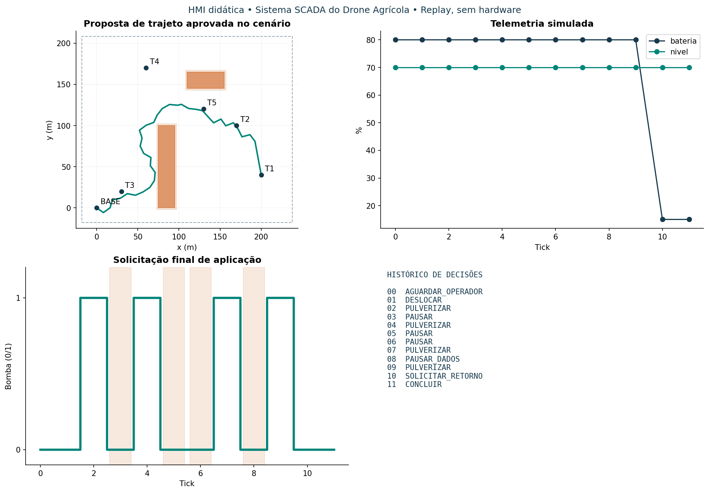

# Aula 28 — Apresentação e simulação do módulo 3

**ECAA08 — Arquitetura de Sistemas SCADA | Grupo 06**  
**Integrantes:** Arthur, Caique, Luis Felipe e Marina  
**Planta:** Sistema SCADA aplicado a um Drone Agrícola de Pulverização  
**Etapa 3:** Árvores — planejamento e execução supervisionada de missões de pulverização

## 1. Contexto e objetivo no SCADA

Esta aula reúne as nove aplicações de árvores em um demonstrador do Sistema SCADA do Drone Agrícola. O foco é mostrar o fluxo entre planejamento, aquisição simulada, supervisão, histórico e HMI. A entrega inclui um painel de replay em HTML e um painel estático com as variáveis e decisões.

O cenário contém 12 snapshots: espera por aprovação, deslocamento, entrada na faixa, vento alto, recuperação do vento, indício de obstrução, falha retida após parada, inspeção e rearme, indisponibilidade de comunicação, recuperação, solicitação de retorno por bateria baixa e pouso confirmado pelo simulador.

## 2. Modelo e fundamentação

A integração usa os mesmos módulos das aulas anteriores, com responsabilidades distintas:

| Aula | Participação no demonstrador |
|---|---|
| 19 | Referência de conectividade entre base e acessos |
| 20 | Serialização e recuperação dos tipos de eventos gerados |
| 21 | Índice temporal dos registros completos da missão |
| 22 | Caminhos geométricos de ida e retorno |
| 23 | Topologia da LAN antes e depois da falha de enlace |
| 24 | Verificação das transições e marcações da missão |
| 25 | Decisão supervisória reativa a cada snapshot |
| 26 | Consulta do ponto cadastrado mais próximo |
| 27 | Sugestão consultiva de classe operacional |

A árvore de comportamento produz a ação. A rede de Petri verifica a coerência da mudança de fase; ela não substitui a avaliação dos sensores. A saída final da bomba exige todos os permissivos. O historiador registra IDs únicos mesmo quando um alarme e uma ação ocorrem no mesmo instante.

## 3. Procedimento e demonstração

1. Apresentar a arquitetura SCADA e a distinção entre campo, aquisição, servidor e HMI.
2. Mostrar a AGM, o caminho RRT e a aprovação registrada pelo cenário.
3. Executar o replay e acompanhar nível, pressão, vazão, bateria, vento e alarmes.
4. Destacar a pausa por vento e a retenção após indício de obstrução.
5. Mostrar a falha de enlace, o novo STP e a recusa de tratar telemetria vencida como atual.
6. Conferir histórico, transições Petri e ida/volta da codificação.
7. Encerrar com as limitações e a diferença entre simulação e atuação real.

Sugestão para uma apresentação de 12 minutos: 2 min de arquitetura e contexto; 3 min de planejamento e dados; 4 min de replay; 2 min de validação; 1 min de limites.

## 4. Experimentos e evidências

[Notebook executável](28_Apresentacao_e_Simulacao_do_Modulo_3.ipynb) · [Código comum](Arquivos_de_Apoio/scada_arvores.py) · [Verificações](Arquivos_de_Apoio/verificacoes.py)

- Replay de supervisão e histórico
- Painel HMI e comparação antes/depois da falha

[Abrir/baixar painel de replay](Arquivos_de_Apoio/Painel_SCADA.html) · [Telemetria do replay](Arquivos_de_Apoio/Telemetria_Simulacao.csv)

### Resultados obtidos

A execução integrou **12 snapshots e 16 eventos**, encerrando em **CONCLUIDA**. Neste lote curto, Huffman ocupa **35 bytes**, contra **16 bytes** da codificação fixa: não há ganho de compressão.

## 5. Interpretação, limites e continuidade

Os instantes são índices de snapshots, sem relação com tempo de voo. O simulador confirma entrada na faixa e pouso; não integra posição, dinâmica, consumo ou cobertura agrícola. Bateria e nível são leituras fictícias, não resultados de um modelo de autonomia. A recuperação da LAN é um evento de cenário, não uma medição de RSTP.

O painel HTML reproduz resultados calculados; seus controles navegam no histórico e não enviam comandos. Não há conexão com rádio, Elipse, RTU física ou atuadores. O projeto continua sendo um SCADA em desenvolvimento por etapas: as funções implementadas aqui são módulos didáticos integrados de supervisão. As Etapas 1 e 2 permanecem como entregues.

Todos os arquivos usam caminhos relativos. No GitHub, leia o README, os documentos e as imagens; para executar o painel HTML, baixe a pasta e abra o arquivo localmente. Para recalcular os resultados, execute o notebook ou o validador.

## 6. Referências

- [README da Etapa 3](README.md).
- [Continuidade e hipóteses](Arquivos_de_Apoio/Continuidade_e_Hipoteses.md).
- [Relatório de validação](Arquivos_de_Apoio/Relatorio_de_Validacao.md).