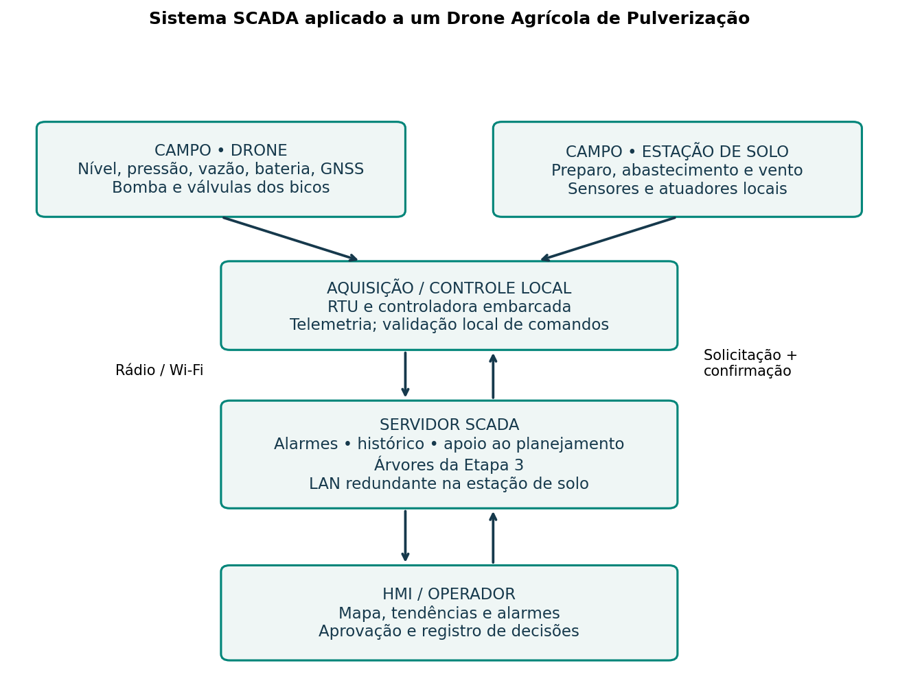
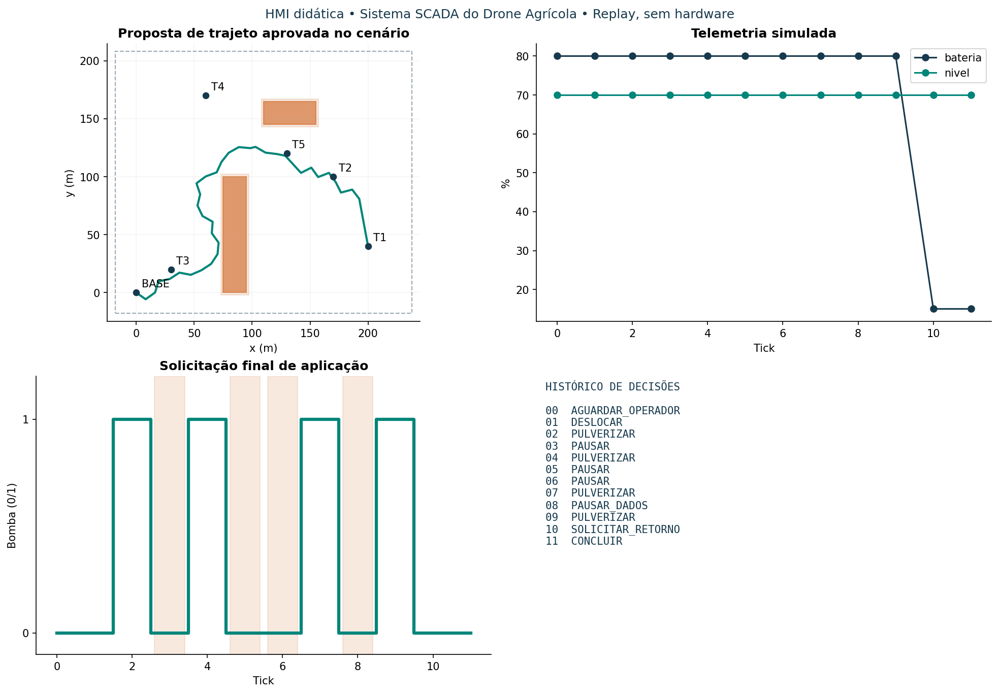

# 🚁 ECAA08 — Arquitetura de Sistemas SCADA | Grupo 06

## Etapa 3 — Árvores

**Planta: Sistema SCADA aplicado a um Drone Agrícola de Pulverização**  
**Tema:** Planejamento e execução supervisionada de missões de pulverização  
**Integrantes:** Arthur, Caique, Luis Felipe e Marina  
**Definição inicial da planta:** 10 de agosto de 2026

## 1. Contexto e continuidade do projeto

Todo o projeto é um **sistema SCADA desenvolvido em etapas**. O drone agrícola é o processo supervisionado, com sensores, atuadores, aquisição embarcada, comunicação com a estação de solo, servidor de supervisão, histórico, alarmes e interface do operador. As estruturas de Matemática Discreta são ferramentas para construir essas funções.

A **Etapa 1 — Lógica** definiu permissivos e diagnóstico. A **Etapa 2 — Grafos** explorou representações e algoritmos de conectividade e roteamento. A **Etapa 3 — Árvores** reúne planejamento de deslocamentos, organização e compactação de eventos, supervisão da missão, análise de estados e apoio à decisão. Esta pasta é uma nova entrega completa das aulas 19 a 28; as Etapas 1 e 2 permanecem como entregues.

A planta possui duas frentes: estação de solo para preparo/abastecimento e unidade embarcada para aplicação. Nesta etapa, os mapas representam o terreno e os acessos aos talhões. As conexões da aula 23 representam a rede Ethernet da estação de solo. Não são redes de tubulação industrial adaptadas ao drone.

## 2. Arquitetura SCADA e responsabilidades



| Camada | Papel no projeto | Representação nesta entrega |
|---|---|---|
| Campo | Sensores de pressão, vazão, nível, bateria, vento e posição; bomba e válvulas | Leituras e estados simulados |
| Aquisição | RTU/microcontrolador embarcado e telemetria | Snapshots, qualidade e idade dos dados |
| Supervisão | Alarmes, permissivos, planejamento e histórico | Algoritmos e integração executáveis em Python |
| Interface | Acompanhamento e decisão do operador | Figuras, notebooks e painel de replay local |

O SCADA propõe e supervisiona a missão. O controle de voo e as proteções locais devem permanecer na unidade embarcada. Um trajeto calculado não autoriza a bomba: a autorização exige permissivos válidos, aprovação, condição de voo e posição de aplicação previstas pelo cenário. A árvore aprendida da aula 27 é consultiva.

**Escopo efetivamente implementado:** simulação didática de módulos de supervisão e sua integração. Não há aquisição de hardware, controlador de voo, servidor OPC, comunicação com Elipse ou acionamento real de atuadores. O painel HTML reproduz dados calculados; não é uma HMI conectada ao processo.

## 3. Aulas e entregáveis

Cada aula possui um documento `.md` e um notebook `.ipynb`, com contexto SCADA, fundamentação, implementação, experimentos, resultados, limites e referências. `.ipynb` é a extensão padrão de notebooks Jupyter.

| Aula | Conteúdo | Aplicação no SCADA | Arquivos |
|---|---|---|---|
| 19 | Algoritmos de Kruskal e Prim | Conectividade entre base e acessos aos talhões | [Texto](19_Algoritmo_de_Kruskal_e_Prim.md) · [Notebook](19_Algoritmo_de_Kruskal_e_Prim.ipynb) |
| 20 | Codificação de Huffman | Compactação de códigos de eventos da telemetria | [Texto](20_Codificacao_de_Huffman.md) · [Notebook](20_Codificacao_de_Huffman.ipynb) |
| 21 | Árvores binárias | Índice temporal do histórico de eventos | [Texto](21_Arvores_Binarias.md) · [Notebook](21_Arvores_Binarias.ipynb) |
| 22 | Rapidly-exploring Random Trees — RRT | Proposta de caminho com obstáculos e margem do drone | [Texto](22_Rapidly_exploring_Random_Trees.md) · [Notebook](22_Rapidly_exploring_Random_Trees.ipynb) |
| 23 | Protocolo de Árvore Geradora — STP / RSTP | Redundância Ethernet na estação de solo | [Texto](23_Protocolo_de_Arvore_Geradora_STP_RSTP.md) · [Notebook](23_Protocolo_de_Arvore_Geradora_STP_RSTP.ipynb) |
| 24 | Árvore de atingibilidade e cobertura em Redes de Petri | Fases da missão e crescimento da fila de eventos | [Texto](24_Arvore_de_Atingibilidade_e_Cobertura_em_Redes_de_Petri.md) · [Notebook](24_Arvore_de_Atingibilidade_e_Cobertura_em_Redes_de_Petri.ipynb) |
| 25 | Árvores de comportamento | Prioridades, permissivos, alarmes e rearme | [Texto](25_Arvores_de_Comportamento.md) · [Notebook](25_Arvores_de_Comportamento.ipynb) |
| 26 | KD-Trees | Consultas espaciais no mapa cadastrado | [Texto](26_KD_Trees.md) · [Notebook](26_KD_Trees.ipynb) |
| 27 | Árvores de decisão — algoritmos clássicos de construção | Classificação consultiva de condições operacionais | [Texto](27_Arvores_de_Decisao.md) · [Notebook](27_Arvores_de_Decisao.ipynb) |
| 28 | Apresentação e simulação do módulo 3 | Integração, replay SCADA e apresentação | [Texto](28_Apresentacao_e_Simulacao_do_Modulo_3.md) · [Notebook](28_Apresentacao_e_Simulacao_do_Modulo_3.ipynb) |

## 4. Organização para o GitHub

Adicione a pasta **`etapa-03-arvores`** à raiz do repositório do grupo, ao lado das etapas anteriores. Dentro dela ficam apenas o README e os dez pares de aulas. Todos os materiais complementares ficam em **`Arquivos_de_Apoio`**:

| Arquivo ou pasta | Finalidade |
|---|---|
| `Imagens/` | 12 figuras originais: arquitetura, árvores, mapa, rede, estados e painel |
| `scada_arvores.py` | Implementações compartilhadas e integração da missão |
| `cenario.json` | Mapa, obstáculos, margem geométrica e hipóteses |
| `visualizacao.py` | Reprodução das figuras a partir dos modelos |
| `verificacoes.py` | Verificações específicas de cada aula |
| `validar_notebooks.py` | Execução independente e relatório de validação |
| `gerar_apoio.py` | Reprodução da arquitetura, CSVs e painel HTML |
| `requirements.txt` | Dependências Python |
| `catalogo_aulas.json` | Nomes padronizados e ordem dos entregáveis |
| `Telemetria_Simulacao.csv` | 12 snapshots da demonstração integrada |
| `Historico_Simulacao.csv` | 16 eventos registrados na demonstração |
| `Dados_Classificacao.csv` | 600 amostras sintéticas, missão e partição de aprendizagem |
| `Painel_SCADA.html` | Replay navegável e autossuficiente, sem conexão externa |
| `Continuidade_e_Hipoteses.md` | Tags, limiares, decisões de modelagem e relação com etapas anteriores |
| `Relatorio_de_Validacao.md` e `Resultados_Validacao.json` | Evidências e resultados da execução |

Os links e as imagens usam caminhos relativos à pasta. Mantenha essa estrutura ao copiar para o GitHub. Não é necessário copiar caminhos do computador de quem gerou os arquivos.

## 5. Execução

Requer Python 3.10 ou superior. Em um terminal na raiz do repositório:

```bash
python -m pip install -r etapa-03-arvores/Arquivos_de_Apoio/requirements.txt
python -m jupyterlab
```

Abra os notebooks da pasta `etapa-03-arvores`, começando pela aula 19, e execute todas as células. Cada notebook é independente dos resultados das aulas anteriores; o código comum e o cenário devem estar presentes. No Colab, transfira a pasta completa e defina o diretório de trabalho para ela antes de executar. Enviar apenas um notebook não transfere suas dependências locais.

Para validar todos os notebooks em processos Python separados:

```bash
python etapa-03-arvores/Arquivos_de_Apoio/validar_notebooks.py
```

Para execução por kernels Jupyter, em um ambiente que permita iniciar kernels:

```bash
python etapa-03-arvores/Arquivos_de_Apoio/validar_notebooks.py --jupyter
```

Para regenerar os arquivos do replay:

```bash
python etapa-03-arvores/Arquivos_de_Apoio/gerar_apoio.py
```

Baixe a pasta e abra [Painel_SCADA.html](Arquivos_de_Apoio/Painel_SCADA.html) em um navegador. Os botões Anterior/Próximo e o seletor apenas percorrem o histórico. Na visualização comum do GitHub, HTML aparece como código; os documentos Markdown e as figuras podem ser consultados diretamente.

## 6. Demonstração integrada — aula 28

O roteiro parte da espera por aprovação, passa pelo deslocamento e aplicação, injeta vento elevado, indício de obstrução e falha de comunicação, demonstra retenção e rearme e termina com retorno solicitado e pouso confirmado pelo simulador.



As nove aplicações participam da demonstração: AGM como referência de conectividade; RRT para os caminhos; KD-Tree para proximidade; STP para a LAN; árvore de comportamento para a ação supervisória; Petri para validar fases; árvore aprendida para sugestão; BST para histórico; Huffman para compactar os tipos de eventos. O histórico completo, com instante e identificador, é preservado separadamente: Huffman não está comprimindo todos os campos da telemetria.

O caso curto integrado revela uma limitação importante: 16 eventos ocupam 35 bytes com Huffman e 16 bytes com codificação fixa. Na aula 20, o lote de 194 eventos ocupa 74 e 83 bytes, respectivamente. O custo do dicionário é contabilizado, portanto a compressão não é apresentada como ganho automático.

## 7. Validação e resultados

Os **10 notebooks e suas 56 células de código** foram executados, cada notebook em um processo Python novo, com saídas e figuras gravadas. O formato foi validado com `nbformat`. O ambiente de geração não permitiu iniciar kernels Jupyter; por isso, a evidência registrada é de execução sequencial das células em Python, não de uma sessão Jupyter. A opção `--jupyter` permite repetir essa checagem no computador do grupo.

As verificações incluem custo mínimo e floresta desconexa; recuperação exata e corrupção de pacotes; consultas e degeneração da BST; colisões em segmentos e falha de planejamento; eleição da raiz e falha de enlace; invariantes e cobertura de Petri; bloqueios e rearme; KD-Tree contra força bruta; separação de missões na aprendizagem; e sequência integrada da saída da bomba.

Consulte o [relatório de validação](Arquivos_de_Apoio/Relatorio_de_Validacao.md) e os [resultados estruturados](Arquivos_de_Apoio/Resultados_Validacao.json). Os resultados numéricos de cada aula estão em seu documento e nas saídas do notebook.

## 8. Hipóteses e limites

- O mapa é bidimensional e hipotético, em metros. Os pontos de acesso mantêm a referência da Etapa 2; obstáculos e dimensões de segurança são hipóteses explícitas desta etapa.
- A margem de 2 m combina raio ilustrativo de 0,6 m com folga de 1,4 m; não é uma especificação do equipamento real do grupo.
- A AGM não é rota completa nem plano de cobertura. RRT não otimiza a missão nem modela vento, dinâmica, altitude, consumo ou obstáculos móveis.
- STP/RSTP são estudados na LAN da estação de solo. A simulação simplifica mensagens e temporização; não implementa um switch ou protocolo de rádio.
- Uma fila ilimitada em Petri é uma abstração de backlog. A classificação aprendida usa dados sintéticos e não valida diagnóstico em campo.
- Os 12 ticks são snapshots, sem modelo de duração de voo. A entrada na faixa e o pouso são confirmações do cenário.

A [continuidade e as hipóteses](Arquivos_de_Apoio/Continuidade_e_Hipoteses.md) detalham os limiares e as responsabilidades. O uso de IA no desenvolvimento é permitido pela disciplina; o grupo deve conseguir explicar os modelos, executar as verificações e justificar suas limitações.

## 9. Referência de organização

A estrutura documento + notebook + imagens foi inspirada no [repositório do professor — Etapa 3](https://github.com/valerio-unifei/ECAA08-2026.2-Projeto/tree/main/etapa-03-arvores). Na consulta de 16/11/2026, a pasta disponibilizava materiais das aulas 19 a 21 e imagens. As aulas 22 a 28 seguem a sequência informada para o projeto do grupo. Os exemplos, implementações e figuras desta entrega foram elaborados para o SCADA do drone agrícola; não reproduzem a planta industrial da referência.

As fontes técnicas específicas estão ao final de cada aula.
